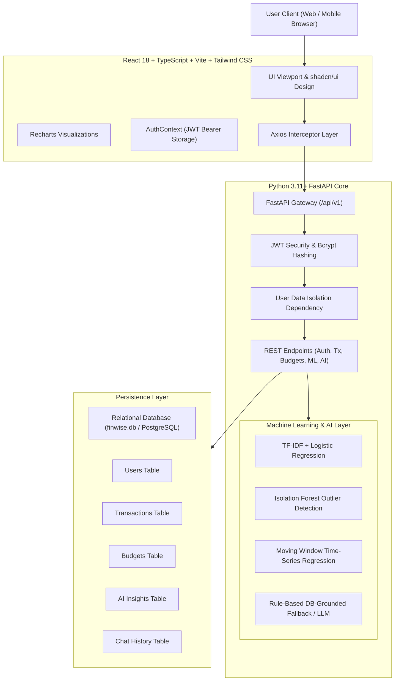

# FinWise AI — System Architecture & Implementation Plan

FinWise AI is an enterprise-grade intelligent personal finance platform engineered for full-stack data isolation, deterministic financial intelligence, and machine learning telemetry.

## Relational Database Schema Design

1. **Users (`users`)**
   - `id`: Integer, Primary Key, Indexed
   - `name`: Varchar(100)
   - `email`: Varchar(255), Unique, Indexed
   - `hashed_password`: Varchar(255)
   - `currency`: Varchar(10), Default "INR"
   - `created_at`, `updated_at`: Timestamps

2. **Transactions (`transactions`)**
   - `id`: Integer, Primary Key, Indexed
   - `user_id`: Integer, Foreign Key -> `users.id`
   - `description`: Varchar(255)
   - `amount`: Float
   - `transaction_type`: Enum ('income', 'expense')
   - `category`: Varchar(50), Indexed
   - `transaction_date`: Date, Indexed
   - `is_flagged_anomaly`: Boolean, Default False
   - `anomaly_reason`: Varchar(255)
   - `anomaly_score`: Float
   - `review_status`: Enum ('unreviewed', 'confirmed_ok', 'reviewed')
   - `created_at`, `updated_at`: Timestamps

3. **Budgets (`budgets`)**
   - `id`: Integer, Primary Key, Indexed
   - `user_id`: Integer, Foreign Key -> `users.id`
   - `category`: Varchar(50)
   - `monthly_limit`: Float
   - `month`: Integer (1-12)
   - `year`: Integer
   - Unique Constraint: `(user_id, category, month, year)`

4. **AI Insights (`ai_insights`)**
   - `id`: Integer, Primary Key, Indexed
   - `user_id`: Integer, Foreign Key -> `users.id`
   - `insight_type`: Varchar(50)
   - `title`: Varchar(150)
   - `message`: Text
   - `severity`: Varchar(20) ('info', 'warning', 'success')
   - `created_at`: Timestamp

5. **Chat History (`chat_history`)**
   - `id`: Integer, Primary Key, Indexed
   - `user_id`: Integer, Foreign Key -> `users.id`
   - `message`: Text
   - `response`: Text
   - `intent`: Varchar(50)
   - `created_at`: Timestamp
